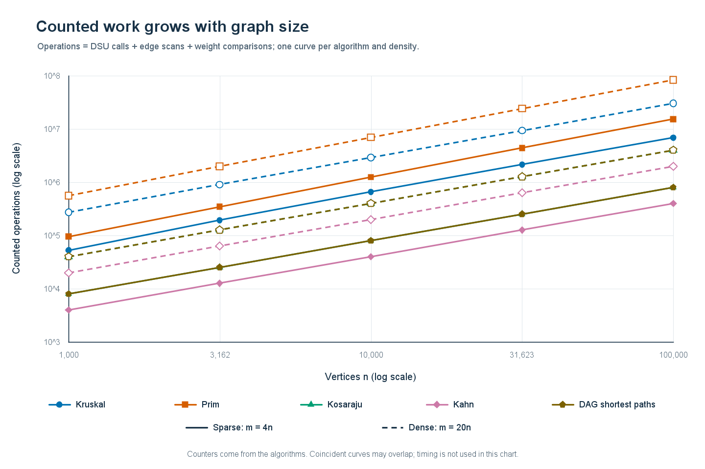
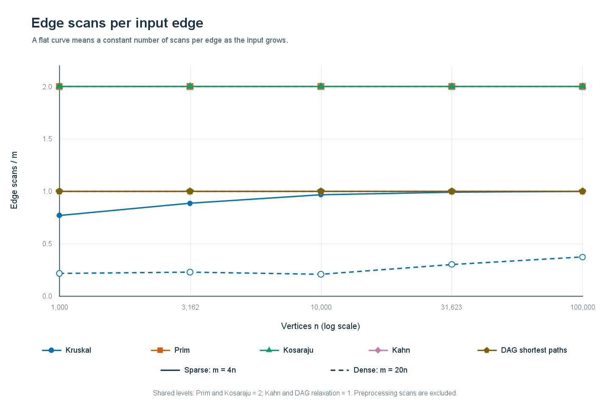
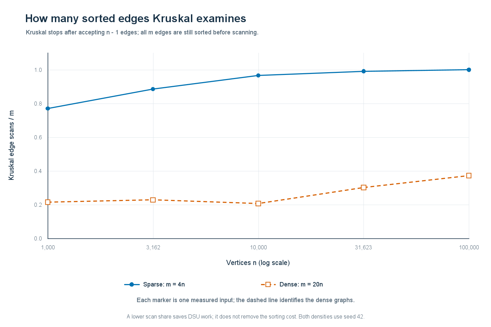

# Assignment 3: Graphs, DSU, MST, SCC and Shortest Paths

**Student:** Aisha Kazbekova | **Group:** SE-2518

## 1. Scope and reproducibility

The city-road problem requires a cheapest spanning network; the scheduler requires
dependency ordering, deadlock groups and minimum-cost routes. One adjacency-list
`Graph` supports directed and undirected integer-weight graphs. DSU, Kruskal, lazy
Prim, iterative Kosaraju, Kahn and DAG shortest paths are implemented directly.
File input accepts `n m directed|undirected` followed by `u v w` edges. Disconnected
MST inputs produce forests, and loops, parallel edges and isolated vertices are supported.

The full experiment uses five vertex counts, two densities (`E=4V` and `E=20V`),
and three graph kinds at every setting. Each generator starts with `new Random(42)`;
the undirected generator first builds a shuffled random spanning tree. Benchmark
assertions check both MST weights, the published result values, valid topological
orders and exact traversal counters. Each recorded time is the median of five runs;
counters must agree across those runs. The CSV contains 50 algorithm/graph rows.

Reproduce with `mvn clean test`, then `mvn exec:java -Dexec.mainClass=benchmark.Benchmark`,
`mvn exec:java -Dexec.mainClass=benchmark.Plotter`, and
`mvn exec:java -Dexec.mainClass=benchmark.Report`. Run commands from the project root.

## 2. Complexity and counted work

Here `V=n`, `E=m`; extra space excludes the original graph but includes algorithm
data and returned structures. Logarithms use a minimum argument of two for empty cases.

| Algorithm | Time | Extra space | Justification |
|---|---|---|---|
| DSU find / union | Amortized O(alpha(V)); makeSet O(V) | O(V) structure, O(1) per call | Union by size limits height; iterative path compression flattens paths. |
| Kruskal | O(V + E log E + E alpha(V)) | O(V + E) | Copy and sort edges, then test endpoints using DSU. |
| Lazy Prim | O(V + E log E) | O(V + E) | Candidate-edge heap can hold O(E) entries, including stale entries. |
| Kosaraju | O(V + E) | O(V + E) | Two DFS passes and an explicitly stored transpose. |
| Kahn | O(V + E) | O(V) | Build indegrees; enqueue each vertex once and process its edges. |
| DAG shortest paths | O(V + E) | O(V) | Topological preparation followed by one relaxation pass. |

For Prim, `log E` is stated explicitly because parallel edges are allowed. For
simple graphs the usual `log V` formulation is equivalent up to a constant factor.

Counters are incremented inside the implementations. `dsu_ops` counts find calls
plus successful unions, not individual parent-pointer steps. `comparisons` counts
sorting/heap weight comparisons, or candidate-distance comparisons for DAG paths.
`edge_scans` counts Kruskal's examined candidates, Prim's adjacency entries, the two
Kosaraju DFS passes, Kahn's removal loop, or DAG relaxations. Transpose/indegree
construction and DAG's internal Kahn preparation are excluded from this scan counter
but included in algorithm runtime and complexity. `max_depth` records the deepest
explicit DFS stack; zero for algorithms without one.

<!-- PAGEBREAK -->

## 3. Results and normalized counters

These values are read from `results/results.csv`. The benchmark checks each against
the course handout before saving the file, and checks Kruskal equals Prim.

| V | E | MST weight | SCC count | Sum of DAG distances |
|---:|---:|---:|---:|---:|
| 1000 | 4000 | 147970 | 27 | 396274 |
| 1000 | 20000 | 30363 | 1 | 252411 |
| 3162 | 12648 | 468911 | 137 | 1271911 |
| 3162 | 63240 | 97589 | 1 | 723157 |
| 10000 | 40000 | 1486139 | 373 | 3941828 |
| 10000 | 200000 | 309550 | 1 | 2381342 |
| 31623 | 126492 | 4715515 | 1188 | 12551891 |
| 31623 | 632460 | 968517 | 1 | 7376612 |
| 100000 | 400000 | 15012094 | 3923 | 40096539 |
| 100000 | 2000000 | 3056681 | 1 | 23512087 |

Let `C` be comparisons, `D` DSU operations, and `S` edge scans; K and P denote
Kruskal and Prim. Ratios below use actual measurements, rounded to four decimals.

| V | Density | K: C/(E log2 E) | K: D/S | P: C/(E log2 E) | K: S/E |
|---:|---|---:|---:|---:|---:|
| 1000 | sparse | 0.8914 | 2.3241 | 1.8311 | 0.7705 |
| 1000 | dense | 0.9027 | 2.2322 | 1.8262 | 0.2151 |
| 3162 | sparse | 0.9069 | 2.2825 | 1.8664 | 0.8846 |
| 3162 | dense | 0.8464 | 2.2191 | 1.8488 | 0.2281 |
| 10000 | sparse | 0.8692 | 2.2588 | 1.8998 | 0.9659 |
| 10000 | dense | 0.7839 | 2.2411 | 1.8679 | 0.2074 |
| 31623 | sparse | 0.8091 | 2.2523 | 1.9297 | 0.9909 |
| 31623 | dense | 0.7200 | 2.1656 | 1.8804 | 0.3020 |
| 100000 | sparse | 0.7447 | 2.2502 | 1.9458 | 0.9992 |
| 100000 | dense | 0.6662 | 2.1345 | 1.8921 | 0.3718 |

A roughly bounded comparison/formula ratio supports the expected sorting or heap
growth; it need not be numerically identical at each size. The fixed weight range
creates duplicate keys, and input order affects sorting and heap behavior.

For all five sizes, Kosaraju has `S/(V+E)=2c/(1+c)`: **1.6000** at `c=4` and
**1.9048** at `c=20`. Kahn and DAG relaxation have `S/(V+E)=c/(1+c)`:
**0.8000** and **0.9524** respectively. Prim has exactly `S/E=2`. These constant
ratios confirm linear scanning for each fixed density.

Kruskal performs two find calls per examined edge and one successful union per
selected tree edge, so `D/S=2+(V-1)/S` on these connected inputs. This ratio checks
the implementation's call accounting; it cannot establish the inverse-Ackermann
cost inside find. That amortized guarantee follows from the two DSU heuristics.
Early stopping changes `S/E`, whereas sorting still considers the entire edge list.

<!-- PAGEBREAK -->

## 4. Correctness arguments and algorithm choice

### Cut property: Kruskal and Prim

Take a cut that respects the edges already chosen, meaning no chosen edge crosses it.
Let e be a minimum-weight edge crossing that cut, and consider an MST containing
the chosen forest. If that MST already contains e, adding e is safe immediately.
Otherwise, adding e creates a cycle whose path must contain another crossing edge f.
Since e is lightest across the cut, replacing f with e cannot increase the tree's weight
and preserves a spanning tree containing the previous choices. Kruskal applies this
argument to distinct DSU components when it examines edges in weight order, while
Prim applies it to the cut between visited and unvisited vertices. Repeating the same
argument independently inside every connected component proves correctness for forests;
ties and parallel edges can change the chosen tree but not the optimal total weight.

### Induction on a topological order

Add an imaginary source with a zero-weight edge to every original indegree-zero vertex.
Every vertex of a finite DAG is reachable from one of these original sources, because
following predecessors cannot continue indefinitely without either stopping or forming a cycle.
The base case is correct because every original source starts at distance zero.
Assume all vertices preceding v in a topological order have their correct shortest distances.
Every edge entering v comes from one of those earlier vertices, so its relaxation has already
considered the best path through that predecessor. The minimum of those candidates is
therefore the shortest distance to v, and no later vertex can supply another incoming edge.
This proves one-pass relaxation, while `parent[]` records a predecessor realizing each
improvement and reconstructs the selected path back to a source.

Negative weights are safe here because a DAG contains no cycle, including a negative
cycle, and topological dependencies remain valid. Negative edges are not universally
forbidden in general graphs: Bellman-Ford supports them and detects reachable negative
cycles. Dijkstra's usual greedy correctness argument requires nonnegative weights.

| Situation | Choice | Reason |
|---|---|---|
| Sparse undirected graph, edge list | Kruskal | Sorting plus DSU is simple; no adjacency construction is required. |
| Undirected adjacency list | Prim | Grow a component through available neighbors; restart for a forest. |
| Dense simple graph | Matrix Prim, if available | O(V squared) avoids a large heap; this project implements the required heap version. |
| Directed graph, cycles/deadlocks possible | Kosaraju | Groups mutually reachable jobs; a self-loop can also indicate a cyclic singleton. |
| Need a dependency order or cycle detection | Kahn | Processes zero-indegree jobs; a short order signals a cycle. |
| Weighted DAG, including negative edges | DAG shortest paths | One topological pass, O(V+E). |
| General graph with negative edges | Bellman-Ford | Topological processing is unavailable; negative-cycle checks are necessary. |

JUnit coverage includes a simple DSU reference, 100 random MST comparisons, brute-force
SCC reachability, valid/cyclic orders, Bellman-Ford comparisons on negative-weight DAGs,
and a 100,000-vertex path for stack safety. File fixtures also exercise disconnected and
cyclic graphs. Graph type determines algorithm eligibility before density determines efficiency.

### Measured time

Across the algorithms and densities, recorded medians at V=1,000 range from 0.804 to 7.885 ms; at V=100,000 they range from 31.704 to 2312.147 ms. Report-generation environment: Java 25.0.1, Windows 11 amd64. The CSV is the measured-run record. JIT compilation, allocation, garbage collection, hardware and background load affect these values, especially at the smallest sizes; five-run medians reduce noise but do not make a universal speed ranking. Operation counts, graph representation and asymptotic reasoning are the primary evidence.

<!-- PAGEBREAK -->

## 5. Operation growth and scans per edge

**Figure 1.** Each series is one algorithm and density. Operations are the sum of
`dsu_ops + edge_scans + comparisons`, an explicit instrumentation convention rather
than a count of every CPU instruction. DSU calls and comparisons are different units,
so this aggregate describes growth and must not be treated as a calibrated runtime model.
Kosaraju and DAG shortest paths overlap at `2E` operations: Kosaraju scans twice,
while DAG relaxation records one scan and one distance comparison per edge.

**Figure 2.** Kosaraju and Prim stay at two scans per stored edge; Kahn and DAG
relaxation stay at one. Their coincident lines are expected consequences of the
counter definitions. Kruskal can stop once its DSU reaches one component, so its
scan ratio need not be constant. Its initial sorting work is represented separately
by comparisons; it does not disappear when the candidate scan ends early.

<!-- PAGEBREAK -->

## 6. Kruskal's examined share and fitted slopes

**Figure 3.** A smaller examined share means fewer DSU checks after sorting. It does
not by itself prove that Kruskal is faster, because the full edge list was already
sorted. Prim scans every adjacency entry and pays for heap operations; the decision
therefore also depends on representation, density and queue/sorting comparison counts.

Slopes below are ordinary least-squares fits of `log10(counter)` against `log10(V)`,
using all five sizes independently for each density. A slope of one means that the
measured counter grows linearly with V over this experiment.

| Counter / algorithm | Sparse slope | Dense slope |
|---|---:|---:|
| edge_scans / Kruskal | 1.0550 | 1.1194 |
| edge_scans / Prim | 1.0000 | 1.0000 |
| edge_scans / Kosaraju | 1.0000 | 1.0000 |
| edge_scans / Kahn | 1.0000 | 1.0000 |
| edge_scans / DagShortestPath | 1.0000 | 1.0000 |
| comparisons / Kruskal | 1.0545 | 1.0159 |

The traversal scan slopes are 1.0000 because E is a fixed multiple of V. The handout
also suggests that Kruskal's *edge-scan* slope should show its sorting logarithm;
that mixes two different operations. Sorting compares weights, whereas Kruskal's
subsequent candidate loop examines at most E edges, possibly fewer after early stopping.
Its scan slope therefore reflects the examined share, not a direct measurement of
`E log E`. The separate comparison slope is the appropriate empirical quantity to
inspect for sorting work, without forcing a particular number.

Even that fitted slope need not exactly equal a textbook prediction: `E log E` is a
worst-case growth bound, only five sizes are sampled, and the generator's 1..1000
weight range creates many ties. Java's sorting method and the generated ordering can
affect the observed comparison growth. These limitations explain differences without
changing, fabricating or deriving measured counters from complexity formulas.

**Sources and traceability.** Requirements and reference outputs: the course handout
`DAA_Assignment3_Graphs.pdf`, Assignment 3, sections 1-10. Implementations:
`src/main/java/graph/`, `algorithms/`, `metrics/` and `benchmark/`. Measurements:
`results/results.csv`. The three plots
and every numeric report table are regenerated from that CSV. AI assistance was
used for implementation, tests, explanations and documentation; see the README.
